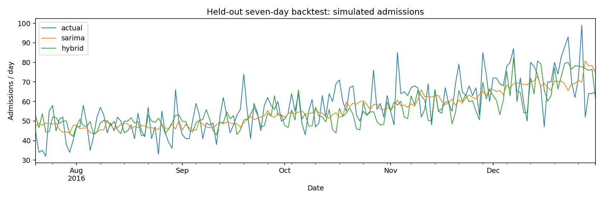
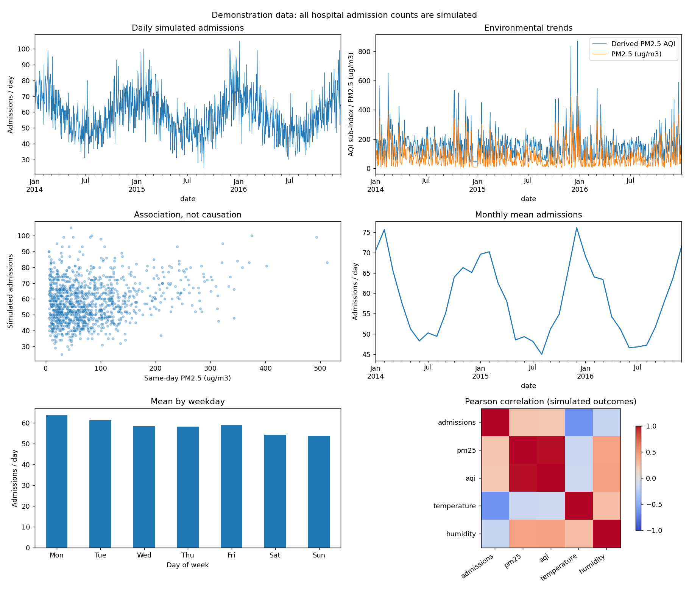

# Air Quality-Driven Hospital Admission Forecasting

A college-level Python project that predicts daily **simulated respiratory emergency admissions** using a weekly SARIMA baseline and an XGBoost residual correction model. It includes exploratory analysis, chronological evaluation, a seven-day backtest and a simple Streamlit dashboard.

**Every admission count is simulated. No real hospital outcomes or hospital identifiers are included. Results do not measure accuracy on real hospitals. This is an academic demonstration, not a medical decision-making system.**

## Dataset and research

The bundled demonstration contains **1,096 daily rows, 2014-01-01 through 2016-12-31**. Environmental observations come from the Aotizhongxin monitoring station in Beijing. The city identifier ends in `-demo` because the paired admissions represent a hypothetical series, not an actual Beijing hospital.

Sources reviewed before implementation:

| Source | What it offers | Decision |
| --- | --- | --- |
| [UCI Beijing Multi-Site Air Quality](https://doi.org/10.24432/C5RK5G) | Hourly pollutants and weather, 2013–2017; CC BY 4.0 | Used one station for three calendar years; no admission labels are supplied |
| [London respiratory admissions research](https://oem.bmj.com/content/73/5/300) | A study of daily emergency admissions and pollution, using Hospital Episode Statistics | The article describes appropriate data but did not provide an immediately usable open matched CSV for this project |
| [ONS response on access to respiratory admissions](https://www.ons.gov.uk/aboutus/transparencyandgovernance/freedomofinformationfoi/accesstodataonrespiratoryandcardiovascularhospitaladmissions) | Explains restrictions on identifiable underlying data; references monthly aggregates | Does not provide the required open daily matched series |
| [London hospital admission rates portal](https://www.data.gov.uk/dataset/ab9bf712-b371-44ec-8c7e-89b4f0f4d29c/hospital-admission-rates1) | Standardized borough-level all-condition admission rates | Different outcome and granularity; not a substitute for daily respiratory counts |

This search did not identify a readily downloadable, appropriately licensed dataset combining all requested fields. It does **not** establish that no such dataset exists anywhere.

Environmental attribution: Chen, S. (2017). *Beijing Multi-Site Air Quality* [Dataset]. UCI Machine Learning Repository. DOI: 10.24432/C5RK5G. Licensed [CC BY 4.0](https://creativecommons.org/licenses/by/4.0/). Adaptations: selecting one station and date range, daily aggregation, and derived humidity/AQI fields. Original hourly data are from Beijing Municipal Environmental Monitoring Center, with meteorology matched to nearby stations.

### Files and units

- `data/environment_observed.csv`: daily environmental observations/derived variables; **no admission labels**. Original daily gaps remain visible.
- `data/admissions_simulated.csv`: explicitly simulated outcomes, seed 2026.
- `data/hospital_air_quality.csv`: joined demonstration input with source labels on every row.
- `data/provenance.json`: source URL, dates, row count and simulation status.
- `pm25`: daily mean PM2.5, micrograms per cubic meter.
- `temperature`: daily mean degrees Celsius.
- `humidity`: daily mean of hourly relative humidity estimates (%), derived from temperature and dew point. It is not a measured humidity column in the original file.
- `aqi`: **derived US PM2.5-only sub-index**, using current PM2.5 breakpoints retrospectively. It is not official Beijing AQI, a multi-pollutant index, or a historical published AQI observation. Values above 500 are extrapolated using the top band.
- `admissions`: nonnegative integer **simulated** daily respiratory emergency arrivals resulting in admission. No bed occupancy or oxygen use is modeled.

Daily means require at least 18 valid hourly readings for the relevant variable. This is a project quality rule, not a claim of regulatory certification. The bundled PM2.5 series has 37 missing daily means; AQI is missing on those same dates. Other retained environmental fields have no daily gaps.

The humidity calculation uses `100 * exp(17.625*dewpoint/(243.04+dewpoint) - 17.625*temperature/(243.04+temperature))`, clipped to 0–100%. See [EPA humidity algorithm](https://qed.epa.gov/hms/meteorology/humidity/algorithms/). AQI uses truncated PM2.5 concentrations and linear interpolation of the bands in the [AirNow technical document, Table 6](https://document.airnow.gov/technical-assistance-document-for-the-reporting-of-daily-air-quailty.pdf) (accessed 2026-10-09).

### Simulation

The generator draws Poisson admission counts with an expected level of:

```text
49 + 8*winter_cycle + weekday_effect + 0.09*previous_three_day_PM2.5
   + 0.35*max(15-temperature, 0)
```

`winter_cycle = cos(2*pi*(day_of_year-15)/365.25)`. Weekday effects, Monday through Sunday, are `[6, 3, 1, 0, 1, -4, -5]`. Prior pollution exposure excludes the current day. The first unavailable exposure uses a fixed value of 35. The coefficients are illustrative assumptions, not fitted epidemiological risk estimates. This creates seasonal/weekly patterns, noisy counts and a modest delayed pollution association. Modeling a relationship inserted by the generator does not discover a real medical effect.

All required daily CSVs are bundled, so no external download is needed. If the combined file is absent, training generates labels using the bundled environmental file. If both inputs are absent, it generates **fully synthetic environmental data**, also labeled explicitly. `--download` is optional; if that request fails, use the bundled files or run the generator without the flag. The project never silently calls simulated pollution observed data.

## Structure and Python files

```text
Air-Quality-Hospital-Forecasting/
  data/                     # Observed environment and simulated outcomes, kept separate
  models/                   # Locally saved SARIMA/XGBoost models and cleaned history
  results/                  # CSV metrics, predictions, audit, plots and check results
  app.py
  data_preprocessing.py
  train_model.py
  generate_demo_data.py
  check_project.py
  requirements.txt
  README.md
  .gitignore
```

| Python file | Responsibility |
| --- | --- |
| `data_preprocessing.py` | `load_data` parses dates; `clean_data` sorts, deduplicates, checks ranges and creates a daily index; `create_features` builds historical lags; `future_features` constructs inputs using only history |
| `generate_demo_data.py` | Optionally downloads UCI data, aggregates daily predictors, derives humidity/AQI, and reproducibly simulates admissions; includes an offline environmental fallback |
| `train_model.py` | Fits two SARIMA candidates, creates validation residuals, trains XGBoost, backtests seven-day horizons, saves results/models and makes the six EDA plots |
| `app.py` | Loads saved artifacts; displays trends, correlations, metrics, forecasts, threshold alerts and CSV download |
| `check_project.py` | Runs focused assertions, an adversarial leakage check and Streamlit's AppTest widget checks |

Style was informed by the user's [Cookie Cats statistical notebook](https://github.com/RajBhumarkar/Statistical-A-B-Test-Analysis-Cookie-Cats-Mobile-Game/blob/main/notebook/ab_test.ipynb) and [Zomato cleaning notebook](https://github.com/RajBhumarkar/Zomato-Bangalore-Restaurant-Analysis/blob/main/cleaning.ipynb): direct Pandas operations, explicit missing-value checks, ordinary functions and understandable plots. This project uses scripts rather than a large package architecture.

## Technologies and setup

Python, Pandas, NumPy, Matplotlib, statsmodels, XGBoost, scikit-learn, Streamlit and joblib. Only standard-library modules are used for downloading, ZIP reading and metadata. No database, cloud service, deep learning or custom JavaScript.

Tested with Python 3.13 and the pinned versions in `requirements.txt`. From a terminal in the extracted project folder, use:

```powershell
python -m venv .venv
.venv\Scripts\python.exe -m pip install -r requirements.txt
.venv\Scripts\python.exe train_model.py
.venv\Scripts\python.exe check_project.py
.venv\Scripts\python.exe -m streamlit run app.py --server.address 127.0.0.1 --browser.gatherUsageStats false
```

Open `http://localhost:8501`. Stop the server with Ctrl+C. On macOS/Linux, replace `.venv\Scripts\python.exe` with `.venv/bin/python`. Dependency installation requires internet or a prepopulated package cache; data access and subsequent runs do not require internet.

If dependencies are already installed, the exact shorter commands are:

```text
python -m pip install -r requirements.txt
python train_model.py
python check_project.py
python -m streamlit run app.py --server.address 127.0.0.1 --browser.gatherUsageStats false
```

The delivered archive contains trained models, so the dashboard can also be launched directly with compatible installed dependencies. Models are ignored by Git: after a fresh source-only clone, train first. Load only trusted locally generated joblib files.

If an existing Python installation raises `No module named markupsafe._native`, it has an incomplete Streamlit dependency (this occurred in the testing sandbox). Prefer the fresh virtual environment above. Within that environment, `python -m pip install --force-reinstall MarkupSafe==3.0.3` repairs this specific dependency. The sandbox's setup limitations and the exact tested environment are recorded in `results/verification.md`.

Optional dataset regeneration (overwrites demo CSVs; retrain afterwards):

```text
python generate_demo_data.py
python generate_demo_data.py --download
python generate_demo_data.py --synthetic
```

Use **one** of these commands: the first reuses bundled UCI data, the second refreshes it, and the third deliberately replaces the demonstration with fully synthetic environmental data. The reported results below describe only the bundled UCI-based run. If data changes, read the newly calculated metrics in `results/` and update this README.

## Workflow and preprocessing

1. Load dates, reject invalid date/city records and require exactly one city. Multiple cities must be selected separately, never pooled into a single daily series.
2. Keep the first duplicate date/city record, sort dates and insert missing calendar days.
3. Coerce numeric columns and mark implausible values missing: PM2.5 0–1500, AQI 0–3000, temperature -60–60 C, humidity 0–100%, and finite nonnegative integer admission counts. These are broad sanity bounds, not clinical cutoffs.
4. Forward-fill environmental values only. Leading gaps use fixed defaults: PM2.5 35, AQI 100, temperature 15 C and humidity 50%. No backward-fill, full-series means or future interpolation are used.
5. Keep missing admissions as NaN: SARIMA's state-space implementation can handle missing outcomes; scoring and residual training exclude them. Only lag/naive predictors forward-fill earlier admission values, with zero as the documented leading fallback.
6. Use chronological train/validation/test splits; train the residual model on validation forecasts; evaluate on test forecasts; save everything needed by the dashboard.

`results/cleaning_report.json` records missing values, invalid ranges, duplicate removal and inserted dates. For this input there are no duplicates, missing dates or invalid numerical ranges.

## SARIMA explained

SARIMA forecasts a series from its past values and past forecast errors while allowing seasonal patterns. It does not use pollution inputs in this project.

- `p`: how many recent values contribute through autoregression.
- `d`: number of ordinary differences used to remove changes in level.
- `q`: how many past innovations/forecast errors contribute through moving-average terms.
- `P`, `D`, `Q`: corresponding seasonal autoregression, differencing and moving-average orders.
- `s`: seasonal period; `s=7` represents a weekly pattern in daily observations.

Two candidates, `(1,0,1)(1,0,0,7)` and `(1,1,1)(1,0,0,7)`, are fitted on training data only, with a constant term. Both converged. The lower training AIC selected `(1,1,1)(1,0,0,7)` (AIC 5658.03 versus 5680.67). AIC balances fit and parameter count; it is not test accuracy. Candidate results are saved. The weekly pattern is supported by the weekday EDA and by the known simulation design; this is not a claim about all hospitals.

The naive baseline repeats the corresponding day from the last observed week. It does not use yesterday's actual admission count from inside a forecast horizon.

## Features and XGBoost residual correction

The model uses exactly 11 features:

| Features | Reason and availability |
| --- | --- |
| Day of week, month, weekend | Calendar effects; known for every future date. Weekend partly overlaps day of week but is easy to explain |
| PM2.5 lag 1, lag 3 | Recent exposure; historical observations where available, otherwise explicit forecast assumptions |
| PM2.5 previous-seven-day mean | Recent exposure average; shift by one **before** rolling, excluding the current/future measured values |
| AQI lag 1 | Alternate pollution scale; derived from PM2.5 and therefore strongly redundant, not an independent pollution signal |
| Temperature and humidity | Forecast-day weather assumptions, not actual future weather readings |
| Admissions lag 7 | Same weekday in the previous week; stays strictly before the forecast origin for every horizon day |
| Horizon 1–7 | Allows correction patterns to vary with forecast distance |

At each forecast origin, unknown environmental values for all seven future days are set to the last seven-day historical average. Later-horizon pollution lags use these assumed values if the lag falls after the origin. This exact procedure is used in validation, test and the dashboard. `create_features` alone can describe historical data, but **forecast training must use `future_features` at each origin**, not a full-data historical feature table.

Training steps:

1. Fit SARIMA on the first 767 days.
2. Walk through the next 164 days in non-overlapping blocks of at most seven days. Forecast each whole block before revealing any observations from it.
3. Calculate out-of-sample residuals: `actual - max(0, SARIMA forecast)`.
4. Fit one small XGBoost regressor on these validation features/residuals: 100 trees, depth 3, learning rate 0.05, seed 42. No test-set hyperparameter tuning.
5. For test and future dates, calculate `hybrid = max(0, SARIMA baseline + predicted residual)`.

SARIMA learns temporal structure. XGBoost learns remaining errors associated with calendar/environmental inputs. Residual learning may improve or worsen predictions; it is not guaranteed to help. In-sample fitted SARIMA errors are never used as residual targets.

SARIMA parameters remain fixed after training. Its state is updated with actual observations **only after each complete forecast block**. XGBoost stays frozen after validation. The deployment artifact uses the same parameters with states updated through the final observed date; it is deliberately not refitted on test residuals. Later test origins can use outcomes that have become historical by then, reflecting repeated weekly operation. No within-horizon outcomes are exposed.

## Evaluation and measured results

All figures below are **simulated-admission results**, using real historical environmental inputs and assumed future environmental values.

| Split | Rows | Dates |
| --- | ---: | --- |
| Train | 767 | 2014-01-01 to 2016-02-06 |
| Validation / residual training | 164 | 2016-02-07 to 2016-07-19 |
| Test | 165 | 2016-07-20 to 2016-12-31 |

The test backtest includes 24 origins: 23 full seven-day horizons and a final four-day horizon. Every held-out date is scored once. No random shuffling occurs. Overall metrics pool the 165 test dates, and `results/metrics_by_horizon.csv` also reports each forecast distance separately.

| Model | MAE | RMSE | NRMSE |
| --- | ---: | ---: | ---: |
| Weekly naive | 9.6424 | 12.1608 | 0.2122 |
| SARIMA | 7.6403 | 9.6231 | 0.1679 |
| SARIMA + XGBoost | 7.7012 | 9.4660 | 0.1651 |

- **MAE**: mean absolute error, in admissions/day; typical absolute deviation.
- **RMSE**: square root of mean squared error, in admissions/day; penalizes larger errors more strongly.
- **NRMSE**: RMSE divided by mean actual admissions in the scored test set; unitless. If the mean is zero, NRMSE is unavailable. This is not a percentage-accuracy score.
- **Improvement**: `(SARIMA RMSE - hybrid RMSE) / SARIMA RMSE * 100` = **1.63%**. If baseline RMSE is zero, improvement is unavailable.

Hybrid RMSE is slightly lower, but hybrid MAE is slightly worse. The small improvement is not evidence of statistical significance or real-world hospital accuracy. No metric or threshold was tuned after viewing test results.





## Seven-day forecasts and surge detection

`forecast_next_7_days(history, sarima, residual_model, threshold=80)` returns date, nonnegative SARIMA predictions, residual corrections, nonnegative hybrid predictions and surge status. Expected counts remain fractional; only display formatting rounds them.

For the bundled dataset, “next seven days” means **2017-01-01 through 2017-01-07**, following its last historical date, not the current calendar week. The model flags two of those days at threshold 80. This is a historical demonstration, not a live prediction service.

`High Risk` means **hybrid expected admissions > daily planning threshold**; equality is `Normal`. The dashboard slider ranges from 0 to 200. This threshold concerns daily emergency admission handling, not beds, occupancy, patient severity or oxygen requirements.

Historical alert precision is `correct predicted surge days / all predicted surge days`, scoring only dates with actual observed target values. Here “actual” refers to the held-out **simulated labels**. At threshold 80: **1 correct alert / 2 alerts = 50% precision**, with **7 actual simulated surge days**. Only one of those seven was flagged; high precision alone would not establish useful detection. Two predictions are far too few for a reliable operational conclusion. If there are no alerts, precision displays N/A. The slider recomputes this descriptive score; do not select an “optimal” threshold on the test set.

## Dashboard screenshots

The app provides historical trends, environmental charts, a correlation view, three-model metrics, actual-versus-predicted admissions, per-horizon errors, seven-day predictions, a threshold slider and CSV export. Screenshot verification status and any captured images are documented in `results/verification.md`. The EDA and prediction images above are real generated plots, not dashboard screenshots.

## Executed checks

Run `python check_project.py` to reproduce the focused checks. Successful execution writes the exact checks to `results/checks.json`. Separate server/browser verification is recorded in `results/verification.md`.

The checks cover loading, missing/range handling, duplicates, inserted dates, leakage-safe lags, trained models, hybrid arithmetic, chronological evaluation, nonnegative seven-day predictions, threshold equality/changes, missing-label precision, and Streamlit rendering/widget behavior. The adversarial check changes all seven future outcomes and environmental readings, then confirms that **every forecast in that horizon remains identical**.

## Important limitations and interview discussion

- There are zero real hospital outcome series. The hypothetical label generator omits infections, epidemics, demographics, population changes, hospital policy, reporting delays and changing disease patterns.
- One environmental monitor cannot represent a city's exposure or a hospital catchment. Daily aggregation and forward filling can hide exposure peaks and prolonged missing periods.
- Humidity and AQI are derived; AQI/PM2.5 features are strongly dependent. AQI uses a US scale applied retrospectively, not the local published scale.
- Future pollution/weather use a constant seven-day mean assumption; unexpected episodes will not be anticipated. Same-day measurements are assumed available only after a day ends. Real reporting delays would require longer lags.
- Residual training covers only 164 days and does not span every season. This limits how much XGBoost can learn; monthly/calendar features do not fix absent seasonal training examples.
- Weekly SARIMA has no annual seasonal term. Annual drift is only partially handled; two candidates are a teaching compromise, not exhaustive model selection.
- The hybrid is a point forecast without calibrated uncertainty intervals. Nonnegative clipping does not turn SARIMA into a count-distribution model. A threshold flag is not a probability of a surge.
- One chronological split, no confidence intervals and two positive alert predictions cannot support generalization or deployment claims. Correlation and synthetic feature importance would not establish causation.
- The project has no live data ingestion, authentication or clinical validation; those are outside this academic scope.

## Resume-ready bullets

- Built a reproducible Python forecasting project using 1,096 daily environmental records and explicitly simulated respiratory admission counts, with audited preprocessing and 11 forecast-time features.
- Evaluated weekly naive, SARIMA and SARIMA–XGBoost forecasts across 24 held-out forecast origins; achieved hybrid RMSE 9.47 versus SARIMA 9.62, a 1.63% reduction on simulated admissions.
- Developed a Streamlit dashboard with seven-day forecasts, configurable daily-admission threshold alerts and CSV export; verified leakage protection through future-data perturbation tests.
